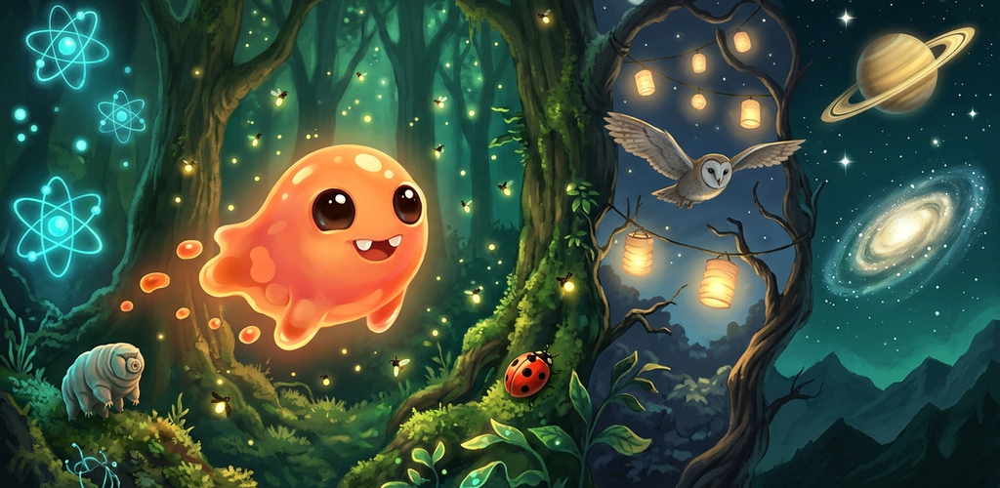
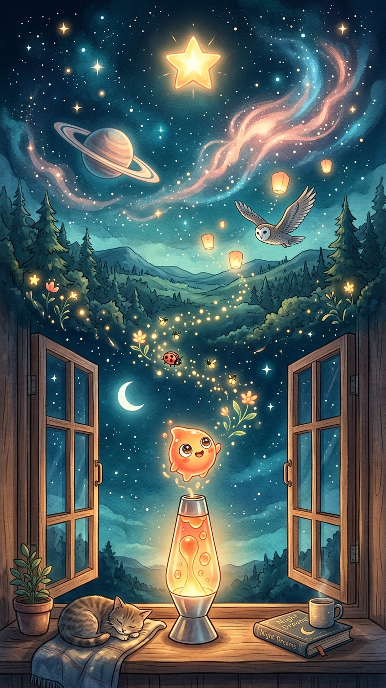
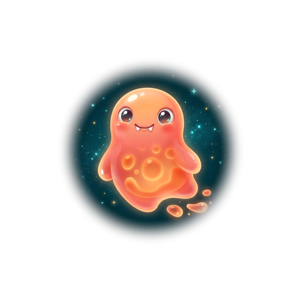
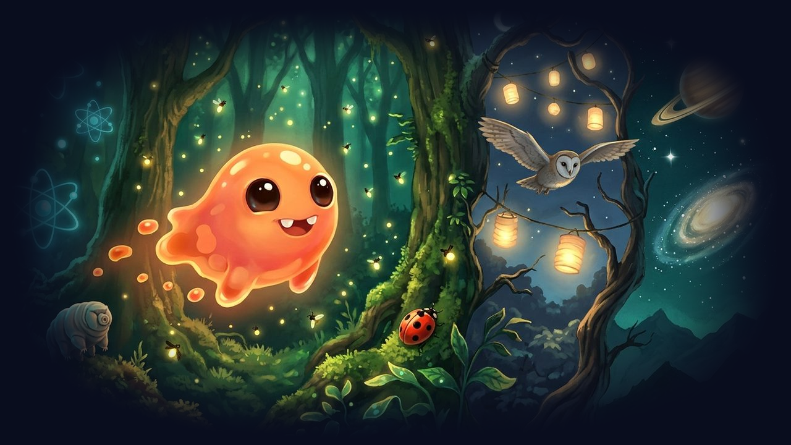

# Kit Store — CHARLIE : De l'atome au cosmos

Tout est prêt pour préparer la publication de **CHARLIE** sur le **Google Play Store** et l'**Apple App Store** — sans publicité, sans achat intégré, sans collecte de données, et adapté dès **3 ans**.

---

## 1. Visuels Marketing & Icônes Natives

| Aperçu | Asset dans le dépôt | Dimensions | Usage Store / Natif |
| :--- | :--- | :--- | :--- |
|  | [`store/assets/app-store-icon-1024x1024.png`](assets/app-store-icon-1024x1024.png) | `1024 × 1024` RGB | Icône Apple App Store (sans canal alpha) |
|  | [`store/assets/play-store-icon-512x512.png`](assets/play-store-icon-512x512.png) | `512 × 512` RGB | Icône Google Play Store |
|  | [`store/assets/play-store-feature-1024x500.png`](assets/play-store-feature-1024x500.png) | `1024 × 500` RGB | Bannière *Feature Graphic* Google Play |
|  | [`store/assets/promo-poster-1080x1920.png`](assets/promo-poster-1080x1920.png) | `1080 × 1920` RGB | Visuel promo vertical / réseaux / fiche |
|  | [`assets/icons/android-adaptive-foreground.png`](../assets/icons/android-adaptive-foreground.png) | `432 × 432` RGBA | Icône adaptative Android (premier plan, zone sûre 66 %) |
|  | [`assets/icons/android-adaptive-background.png`](../assets/icons/android-adaptive-background.png) | `432 × 432` RGB | Icône adaptative Android (arrière-plan cosmique `#090d1e` → `#171f42`) |
|  | [`assets/art/boot-splash.png`](../assets/art/boot-splash.png) | `1280 × 720` RGB | Écran de lancement natif Godot (`boot_splash`) |

---

## 2. Fiche Store — Français (FR)

- **Nom de l'app (30 car. max)** : `CHARLIE : De l'atome au cosmos`
- **Sous-titre iOS (30 car. max)** : `Grandis de l'atome aux étoiles`
- **Description courte Play Store (80 car. max)** :
  `Guide la petite Charlie de l'atome aux galaxies dans un conte lumineux dès 3 ans.`
- **Identifiant (Package / Bundle ID)** : `com.doranooo.charlie`
- **Catégorie** : Jeux → Arcade / Grand public (*Casual*) · Programme Famille
- **Classification** : **PEGI 3** / **4+** (aucune violence réaliste, aucune pub, aucun achat intégré)

### Description longue (FR)
> Une nuit calme, une minuscule goutte lumineuse s'échappe d'une vieille lampe à lave pour rejoindre une étoile solitaire tout là-haut dans le ciel…
>
> Guide **la petite Charlie**, une adorable créature fluide aux deux petites dents, dans un voyage poétique et tactile de l'infiniment petit jusqu'à l'infiniment grand.
>
> **Un gameplay simple, fluide et addictif**
> - Contrôle Charlie tout en douceur grâce au joystick virtuel.
> - Croque tout ce qui est plus petit que toi pour grandir, et esquive les plus gros !
> - Utilise deux pouvoirs évolutifs : le **Crachat de lave** (qui rétrécit les géants) et l'**Onde & Élan** (qui te propulse et repousse le danger).
> - Surveille les 3 gouttelettes de lave qui suivent Charlie : elles représentent sa vie et se régénèrent naturellement.
>
> **Six mondes bioluminescents à explorer**
> 1. **Quantique** — quarks, photons, atomes et molécules
> 2. **Microscopique** — spores, bactéries, amibes et tardigrades
> 3. **Sous-Bois** — fourmis, lucioles, coccinelles, papillons de nuit et grenouilles
> 4. **Ville Endormie** — lanternes célestes, chouettes, voitures, hélicoptères et dirigeables
> 5. **Planétaire** — astéroïdes, comètes, lunes, planètes et géantes à anneaux
> 6. **Cosmique** — étoiles, nébuleuses, trous noirs et galaxies spirales
>
> **Pensé pour toute la famille (dès 3 ans)**
> - **3 niveaux de difficulté** : **Tout-petit · 3 ans** (sans défaite, rebonds rigolos), **Chill** et **Sauvage**.
> - **7 cinématiques animées** façon album jeunesse (activables ou désactivables dans les options).
> - **100 % gratuit, sans publicité, sans achat intégré, sans collecte de données et jouable hors-ligne.**

---

## 3. Store Listing — English (EN)

- **App Name (30 chars)** : `CHARLIE: Atom to Cosmos`
- **iOS Subtitle (30 chars)** : `Grow from atoms to galaxies`
- **Google Play Short Description (80 chars)** :
  `Guide little Charlie from tiny atoms to spiral galaxies in a cozy glowing tale.`
- **Package / Bundle ID** : `com.doranooo.charlie`
- **App Store Keywords (100 chars max)** :
  `blob,lava lamp,grow,eat,evolution,cosmos,kids,toddler,chill,arcade,offline,no ads,family,space,cute`

### Full Description (EN)
> One quiet night, a tiny glowing droplet slips out of a bedroom lava lamp to reach a lonely Golden Star shining high above…
>
> Guide **little Charlie**, an adorable fluid lava-lamp creature with two tiny teeth, on a tender, tactile journey from the subatomic world all the way to the cosmos.
>
> **Simple, fluid, deeply satisfying gameplay**
> - Glide smoothly with an ergonomic translucent virtual joystick.
> - Chomp anything smaller than you to grow, and weave past bigger creatures.
> - Unleash two evolving powers: **Lava Spit** (shrinks bigger predators) and **Pulse Dash** (bursts forward and pushes danger away).
> - Charlie's 3 trailing lava droplets are her life — eat or stay safe to regenerate them naturally.
>
> **Six handcrafted bioluminescent worlds**
> Quantum → Microscopic → Night Forest (insects!) → Sleeping City (owls, cars, helicopters, blimps) → Planetary → Cosmic.
>
> **Safe for the whole family (Ages 3+)**
> - **3 difficulty modes**: **Toddler (3+)** (cannot lose, playful bounces), **Chill**, and **Wild**.
> - **7 animated storybook cutscenes** (toggleable in Options).
> - **No ads, no in-app purchases, zero data collection, and 100% playable offline.**

---

## 4. Politique de confidentialité (FR / EN)

- **Fichier source dans le dépôt** : [`docs/privacy.html`](../docs/privacy.html) (page autonome bilingue FR/EN).
- **URL publique GitHub Pages** : `https://doranooo.github.io/charlie-mobile-native/privacy.html`
- **Dépôt officiel** : `https://github.com/DoraNooo/charlie-mobile-native`

> [!NOTE]
> Pour activer l'URL GitHub Pages : dans le dépôt GitHub → **Settings → Pages → Source: Deploy from a branch → Branch: `main` / folder: `/docs`**.

> [!TIP]
> Dans le formulaire **Sécurité des données (Data Safety)** de Google Play et **Confidentialité de l'app (App Privacy)** d'App Store Connect, réponds **« Non, cette application ne collecte ni ne partage aucune donnée utilisateur »** (*Data Not Collected*). Les préférences et scores sont enregistrés uniquement en local dans `user://settings.cfg`.

---

## 5. Builds Natifs Godot 4.3 & CI GitHub Actions

Le projet est une application native **Godot 4.3** configurée pour Android et iOS (`export_presets.cfg`, icônes adaptatives Android, écran de lancement `boot-splash.png`, zones sûres / encoches, retours haptiques et pause automatique en arrière-plan).

### Option A — Build automatisé via GitHub Actions (`.github/workflows/build-stores.yml`)
1. Dans ton dépôt GitHub (`https://github.com/DoraNooo/charlie-mobile-native`), configure les secrets pour signer la version Android Release (optionnel pour les APK debug) :
   - `ANDROID_KEYSTORE_BASE64` (keystore `.jks`/`.keystore` encodé en base64)
   - `ANDROID_KEYSTORE_USER` (alias de la clé)
   - `ANDROID_KEYSTORE_PASSWORD` (mot de passe du keystore)
2. Déclenche le workflow **Actions → Build Stores (`build-stores.yml`) → Run workflow** (ou pousse un tag `v1.0.0`).
3. Télécharge les artefacts générés directement depuis le run CI :
   - **Android** : `.aab` (Google Play Store) et `.apk` (test direct sur téléphone Android).
   - **iOS** : projet Xcode prêt à archiver / signer en `.ipa` sur macOS.

### Option B — Build local dans Godot 4.3
- **Android (`.aab` / `.apk`)** :
  1. Installe **Godot 4.3** + **Modèles d'exportation** (*Éditeur → Gérer les modèles d'exportation*).
  2. Installe **JDK 17** et **Android SDK** (via Android Studio) et configure leurs chemins dans *Éditeur → Paramètres → Export → Android*.
  3. Ouvre *Projet → Exporter*, sélectionne le preset **Android (Google Play AAB)** ou **Android (APK)**, renseigne ton keystore Release et clique sur **Exporter le projet**.
- **iOS (Xcode / `.ipa`)** :
  1. Sur macOS avec **Xcode** installé, ouvre *Projet → Exporter → iOS*.
  2. Vérifie le Bundle Identifier `com.doranooo.charlie` et renseigne ton **App Store Team ID**.
  3. Exporte le projet `.xcodeproj`, ouvre-le dans Xcode, puis **Product → Archive → Distribute App → App Store Connect**.

---

## 6. Checklist de soumission pas-à-pas

### A. Captures d'écran (téléphone en plein écran paysage)
Prends **4 à 6 captures** directement depuis un appareil Android/iOS :
1. Écran d'accueil (`CHARLIE — De l'atome au cosmos`)
2. Cinématique d'introduction (lampe à lave)
3. Monde Microscopique (tardigrades & bactéries)
4. Monde Sous-Bois (coccinelles, fourmis, grenouille)
5. Monde Ville Endormie (chouette, lanternes, dirigeable)
6. Monde Planétaire / Cosmique (Saturne & galaxies)

### B. Google Play Console (Android — 25 \$ une seule fois)
- [ ] Créer l'application dans [Google Play Console](https://play.google.com/console) (`com.doranooo.charlie`).
- [ ] Activer GitHub Pages (`/docs`) et renseigner l'URL de confidentialité : `https://doranooo.github.io/charlie-mobile-native/privacy.html`.
- [ ] Remplir **Sécurité des données** : *Aucune donnée collectée ni partagée*.
- [ ] Remplir **Public cible & Contenu** : dès 3 ans (Programme Famille), aucune pub, aucun achat intégré, questionnaire IARC → **PEGI 3**.
- [ ] Téléverser `store/assets/play-store-icon-512x512.png`, `store/assets/play-store-feature-1024x500.png`, les captures d'écran et les fiches FR/EN.
- [ ] Importer le bundle **`.aab`** généré par Godot 4.3 / `build-stores.yml` (signé avec ta clé Release et Google Play App Signing activé).
- [ ] **Comptes personnels récents** : compléter la piste **Test fermé** (12 testeurs inscrits pendant 14 jours continus), puis soumettre en **Production**.

### C. App Store Connect (iOS — 99 \$ / an)
- [ ] Créer l'identifiant d'app `com.doranooo.charlie` dans l'[Apple Developer Portal](https://developer.apple.com/account/) puis la fiche dans [App Store Connect](https://appstoreconnect.apple.com/).
- [ ] Archiver et téléverser le build **`.ipa`** depuis Xcode (*Product → Archive → Distribute App → App Store Connect*).
- [ ] Remplir les fiches FR/EN (nom, sous-titre, mots-clés, description) et téléverser `store/assets/app-store-icon-1024x1024.png` + captures iPhone/iPad.
- [ ] Renseigner l'URL de confidentialité `https://doranooo.github.io/charlie-mobile-native/privacy.html` et déclarer **Données non collectées** (*Data Not Collected*).
- [ ] Classer l'application en **4+** (catégorie **Enfants / Conçu pour les enfants**), confirmer l'absence de pub/IAP/liens externes, tester via **TestFlight**, puis soumettre à validation Apple.
